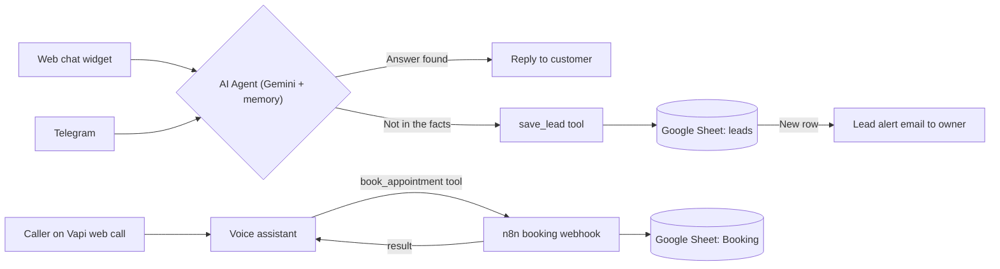
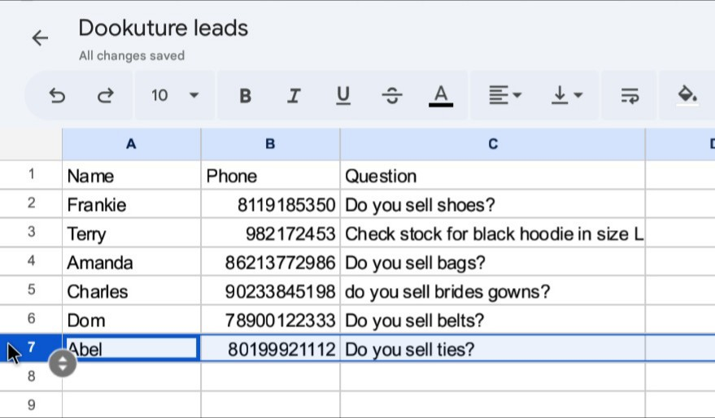
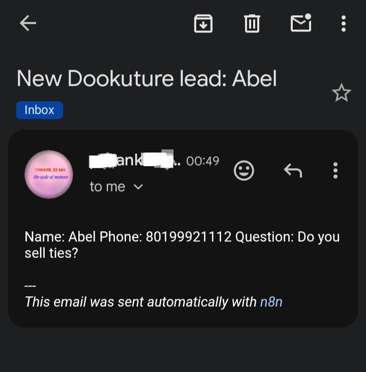
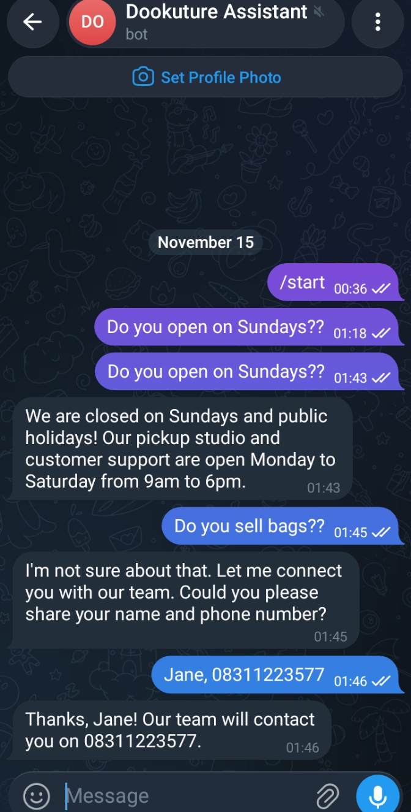
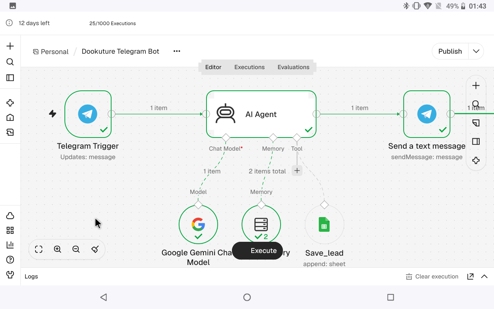
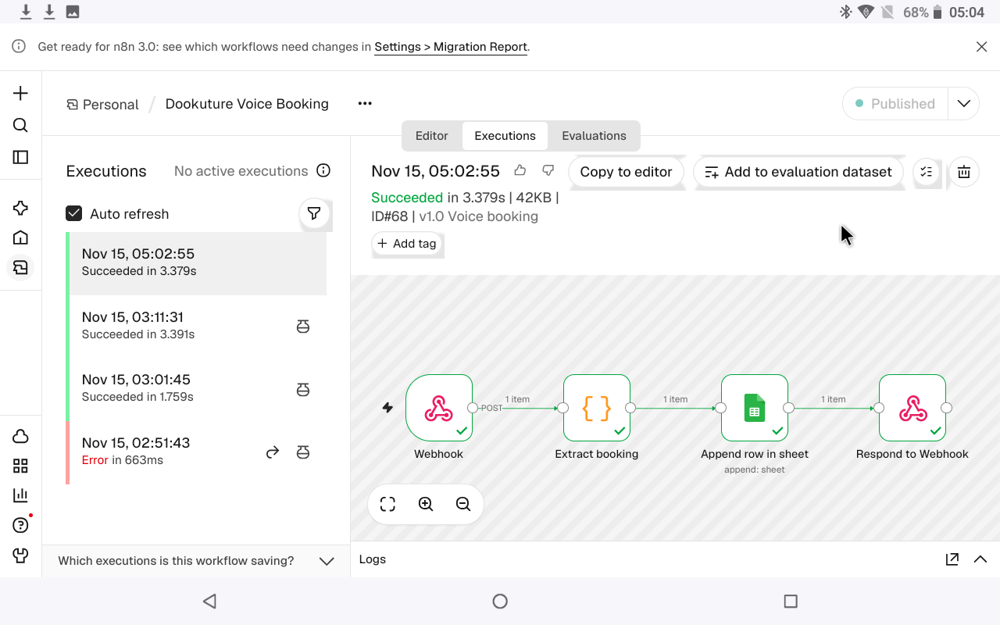
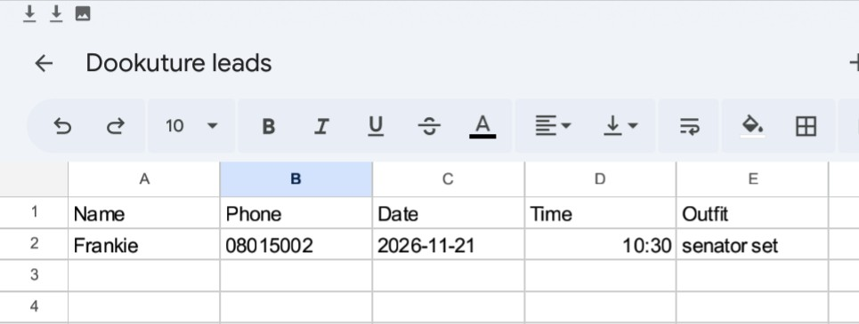
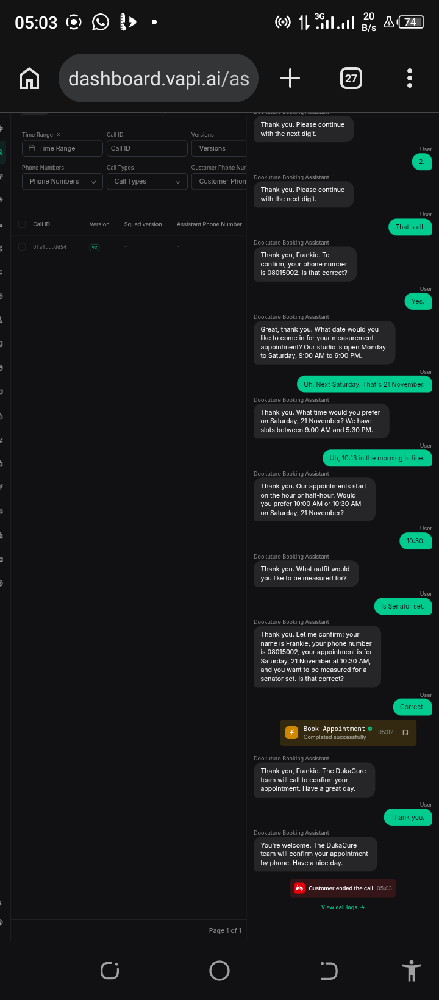
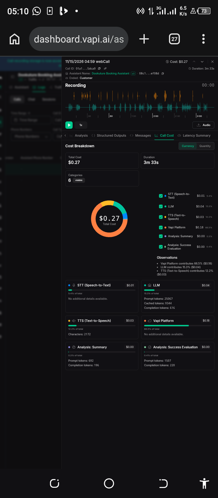
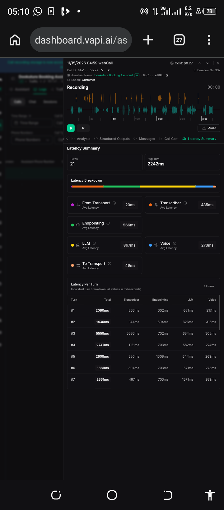

<h1 align="center">Dookuture AI Customer-Service Agent</h1>

<p align="center">
  <b>One AI agent on three channels: web chat, Telegram and voice. It answers only from approved facts, hands off to a human when it can't, and logs every lead and booking.</b>
</p>

<p align="center">
  
  
  
  
  
</p>

<p align="center">
  
</p>

> **Sample project.** Dookuture is a fictional Nigerian clothing brand and all business data is invented. The engineering is real, and every claim below links to evidence in this repo.

## Try it

**[Open the live web demo](https://orkeghenfranklyn.github.io/dookuture-faq-chatbot/)**

The chat is switched on only during demos to protect free-tier quotas. If it doesn't reply, watch the videos below.

## Demo videos

| Video | What it shows | Link |
|---|---|---|
| Web chat and lead capture | Questions answered from facts, memory, a lead saved to Google Sheets and an email alert | [Watch](https://youtu.be/Z1-JhnGCoCY?si=XPiPuE69NZw9fBMt) |
| Voice booking call | A caller books a measurement appointment by voice and the row lands in Google Sheets | [Watch](https://youtube.com/shorts/P6NgoTDETSQ?si=4tVCun-avPgriI3v) |


## At a glance

| | |
|---|---|
| **What it is** | A customer-service agent for a small online clothing retailer, on web chat, Telegram and a voice line |
| **The problem** | Customers message and call after hours and get no answer. A bot that guesses prices or policies causes new problems |
| **The approach** | Facts-only prompting, a fixed fallback, narrowly scoped tools, per-session memory and a human handoff |
| **Evidence** | 15 of 15 chatbot test questions passed. One end-to-end voice call wrote a booking to Google Sheets |
| **Stack** | n8n Cloud, Google Gemini, Vapi, Google Sheets, Gmail, Telegram, GitHub Pages |
| **Built by** | One person, on an Android tablet, using free tiers and starter credits only |

## Channels

| Channel | How it works | Status |
|---|---|---|
| **Web chat** | n8n Chat Trigger in embedded mode, with a GitHub Pages demo page | Verified |
| **Telegram** | Telegram Trigger and Send nodes around the same agent, memory and tools | Verified |
| **Voice** | Vapi assistant on a web call, calling an n8n webhook through a `book_appointment` tool | Verified end to end, with known issues (see below) |
| **WhatsApp** | Needs a Meta developer account. The Telegram build shows the same pattern | Not built |

## How it works



## See it work

| Accurate answer | 
|---|---|
|  | 

| Fallback, then lead capture | Conversation memory |
|---|---|
|  |  |

**Owner alert: a new lead triggers an instant email**

| New lead lands in the sheet | Owner receives the alert |
|---|---|
|  |  |

**Telegram channel: the same agent inside a messaging app**

| Conversation | Workflow |
|---|---|
|  |  |

## Voice booking agent

A caller speaks to a Vapi assistant, which collects a name, phone number, date, time and outfit, confirms them, and calls a `book_appointment` tool. An n8n workflow saves the request to Google Sheets and returns a result the assistant speaks back. It is a **booking request** that the team confirms by phone, because the agent has no calendar to check.

| Booking workflow in n8n | Booking saved in Google Sheets |
|---|---|
|  |  |

| Call transcript with the tool call completing |*
|---|---|
|  |

| Call cost: $0.27 for 3m33s | Latency: 21 turns, 2.2 s average |
|---|---|
|  |  |

> **Honest status.** The pipeline works end to end. The first call also exposed three prompt issues: the phone number was saved with 8 digits and read back without the assistant catching it, the assistant said a wrong company name in two replies, and it collected the number one digit at a time. Fixes are written in [prompt v1.1](prompts/voice-assistant-prompt.md). A retest after the fixes is still pending. Full details: [voice call test log](tests/voice-call-test.md).

## Engineering decisions

| Challenge | Decision | Why it matters |
|---|---|---|
| Models invent plausible details | The prompt answers only from supplied facts and bans invented prices, stock and policies | A wrong price is worse than no answer |
| Unknown questions | A fixed fallback line plus contact capture | Predictable behavior, and the owner gets a lead |
| Questions the bot can't verify | The prompt states what it cannot see and routes to a human | Avoids false confidence on stock and orders |
| Accidental database writes | `save_lead` is described narrowly and fires only with both name and phone | Keeps the sheet clean |
| Prompt injection | A rule against revealing or changing instructions, tested directly | Basic safety for a public-facing bot |
| Shared conversations | Memory is keyed to the chat session or Telegram chat ID | Customers never see each other's context |
| n8n blocks the `arguments` field that Vapi sends | A small Code node extracts the booking fields before any other node reads them | Works around the expression security rule without weakening it |
| Vapi requires an exact reply shape | The webhook returns HTTP 200 with a top-level `results` array and the matching `toolCallId` | A wrong shape makes the assistant silent |
| Vapi waits only a few seconds for a tool | The booking path contains no AI step, and the email alert runs after the response | The tool answers in about 3 seconds |
| Honest scope | The voice agent logs a booking request instead of claiming a confirmed slot | It cannot check availability, and says so |
| Secrets | Keys stay in n8n and Vapi credentials. Exports are sanitized before upload | Safe to publish |

## Testing

**Chatbot:** 15 questions in three categories, each sent as a separate message in a fresh session, plus memory and lead-capture tests. Result: 15 of 15 passed. Full table: [tests/test-cases.md](tests/test-cases.md)

**Voice:** one live web call. Booking pipeline passed. Three prompt issues found, fixes written, retest pending. Log: [tests/voice-call-test.md](tests/voice-call-test.md)


## What it cost

| Item | Cost |
|---|---|
| n8n Cloud | Free trial |
| Google Gemini | Free tier |
| Vapi | Starter credits. One 3m33s call cost $0.27 (about $0.076 a minute) |
| Telegram, Google Sheets, Gmail, GitHub Pages | Free |

## Skills demonstrated

- **Prompt engineering:** facts-only prompts, guardrails, fallbacks, and prompts written for speech
- **Agent design:** tools, memory, session handling, human handoff
- **Voice AI:** assistant design, tool contract, latency and cost reading
- **Workflow automation:** n8n triggers, webhooks, Code nodes, credentials
- **API integration:** Gemini, Vapi, Telegram, Google Sheets, Gmail
- **Testing:** happy-path, edge-case and adversarial tests with documented results, including honest failures
- **Security awareness:** prompt-injection resistance, secret handling, webhook exposure
- **Documentation:** reproducible setup, changelog and stated limitations

## Limitations and roadmap

- [x] FAQ agent with facts-only prompting
- [x] Conversation memory
- [x] Lead capture to Google Sheets
- [x] 15-question test suite
- [x] Instant owner alerts for new leads
- [x] Website chat widget (demo page)
- [x] Telegram channel
- [x] Voice agent (web-call demo, booking request logged to Sheets)
- [ ] Voice retest after the prompt v1.1 fixes
- [ ] Authentication on the booking webhook
- [ ] Calendar availability check for bookings
- [ ] WhatsApp channel (needs a Meta developer account)
- [ ] Persistent memory (Postgres or Redis)

**Known limits**
- **Free-tier constraints.** Gemini's free tier has small daily quotas and may use data to improve Google's products. Real customer traffic needs a paid tier.
- **Demo-only deployment.** Live channels are switched on only during demos. The n8n trial ends, so the videos and screenshots are the permanent proof.
- **Temporary memory.** Simple Memory is lost on restart.
- **Unauthenticated webhook.** The booking endpoint has no authentication, so it is published only during calls.
- **No live data.** The agent cannot check stock, orders or calendar availability.

## Run it yourself

Step-by-step import and credential setup: [Workflow documentation](workflow/README.md)

## Repository structure

```
dookuture-faq-chatbot/
├── README.md
├── CHANGELOG.md
├── docs/            GitHub Pages demo page with the embedded chat widget
├── workflow/        n8n exports (chatbot, lead alert, Telegram, voice booking) and setup guide
├── prompts/         chatbot system prompt and voice assistant prompt
├── tests/           chatbot test suite and voice call test log
└── screenshots/     workflow, chat, voice and evidence screenshots
```

## About the builder

I'm Franklyn. I build AI agents and automations for small businesses. I built this on an Android tablet, from prompt basics to three working channels, and I document failures as carefully as successes.

**Open to freelance projects and AI automation roles.**

### Connect with me

- **GitHub:** [github.com/orkeghenfranklyn](https://github.com/orkeghenfranklyn)
- **LinkedIn:** [linkedin.com/in/franklyn-orkeghen-34bb40441](https://www.linkedin.com/in/franklyn-orkeghen-34bb40441/)
- **Email:** [orkeghenfranklyn@gmail.com](mailto:orkeghenfranklyn@gmail.com)
  

<p align="center"><sub>Sample brand and fictional data. Built with n8n, Google Gemini and Vapi.</sub></p>
